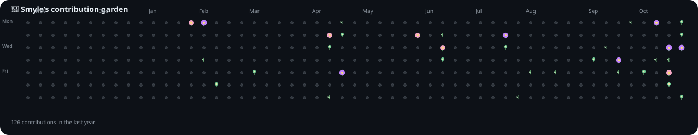

<div align="center">

<a href="https://github.com/Smyle-Goyal">
  
</a>

<p>
  <a href="https://github.com/Smyle-Goyal?tab=followers">
    
  </a>
  <a href="https://komarev.com/ghpvc/?username=Smyle-Goyal">
    
  </a>
  <a href="mailto:YOUR_EMAIL@example.com">
    
  </a>
</p>

<p>
  <a href="https://www.linkedin.com/in/YOUR-LINKEDIN-USERNAME/">
    
  </a>
  <a href="https://github.com/Smyle-Goyal">
    
  </a>
</p>

</div>

---

## 👩‍💻 About me

```text
🎓  B.E. Computer Science (AI & ML) student at Chandigarh University
💻  Full-stack developer who enjoys building clean, useful interfaces
🧠  Currently sharpening React, Node.js, DSA and system design
🚀  Building useful projects and exploring AI-powered applications
⚡  Fun fact: debugging at 3 AM is a feature, not a bug
```

<details>
<summary><b>What I'm focusing on right now</b> ✨</summary>
<br>

- Building production-minded web apps with **React, Node.js and Express**
- Practising **data structures, algorithms and scalable system design**
- Exploring better developer experiences with **Git, Linux and automation**
- Looking for opportunities to collaborate on interesting open-source projects

</details>

## 🧰 Technologies I work with

<p align="center">
  
</p>

## 🌸 My contribution garden

Every square is a day. The more contributions you make, the more the flower blooms. 🌱  
This garden is refreshed automatically by GitHub Actions.

<div align="center">
  
</div>

<p align="center">
  <sub>🌷 Flowers are generated from GitHub's contribution calendar. Greenhouse automation runs daily.</sub>
</p>

## 📊 GitHub at a glance

The contribution garden above is generated from GitHub's contribution calendar. For authoritative live totals, commits, pull requests, issues, stars, and languages, open the profile link below.

<div align="center">
  <a href="https://github.com/Smyle-Goyal">
    
  </a>
</div>

## 🤝 Let's build something

Have an idea, a project, or a bug that refuses to leave? I'd love to hear about it.

<div align="center">
  <a href="mailto:YOUR_EMAIL@example.com"></a>
  <a href="https://www.linkedin.com/in/YOUR-LINKEDIN-USERNAME/"></a>
</div>

<br>

<div align="center">
  <sub>🌼 Keep planting commits. The garden will take care of the flowers.</sub>
</div>
